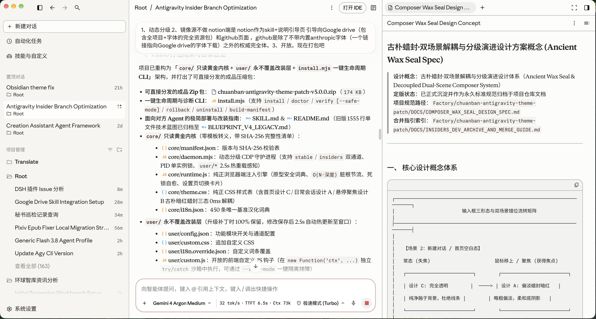
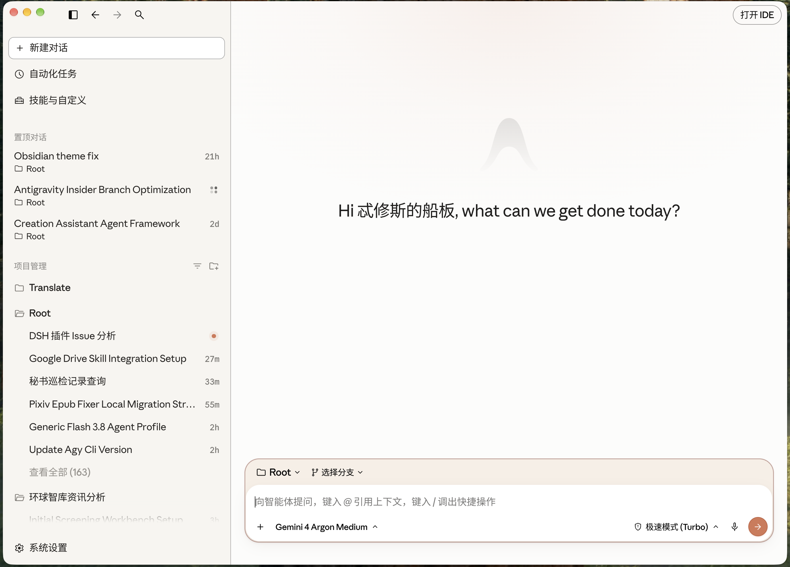

# 船板的 Antigravity 书卷暖纸 × 官方碳黑昼夜双模式主题、字体优化与深度汉化全栈补丁 (v5.2.0 · 适配 Antigravity 2.32.0)

[-339933.svg)](https://nodejs.org/)

> **本页面为补丁主介绍、极简部署指南与版本演进说明。**  
> 供 AI Agent 执行一键安装与二次改装读取的完整技术契约独立存放于仓库根目录的 **[`SKILL.md`](https://github.com/Anarcadia/chuanban-antigravity-theme-patch/blob/main/SKILL.md)**。

---

## 🔗 核心资源链接与三端入口

| 端点名称 | 链接地址 | 定位与包含内容 |
| :--- | :--- | :--- |
| **1. Google Drive 全套资源包（含字体）** | [**Google Drive 官方共享文件夹**](https://drive.google.com/drive/folders/1NX92SgVUqtSjWg6bt6sIJXy-cn7J_boC) | **全项目成品包 + 全套必备字体库**。内置 **Anthropic 官方原版字体族**（`Anthropic Sans` / `Anthropic Serif` / `Anthropic Mono`）与 **更纱黑体超集**（`Sarasa-SuperTTC.ttc`；若大文件偶发触发 Google Drive 24h 下载限流，macOS 可用 `brew install --cask font-sarasa-gothic`，Windows/Linux 可从 [`be5invis/Sarasa-Gothic` Releases](https://github.com/be5invis/Sarasa-Gothic/releases) 获取同款 `Sarasa-SuperTTC.ttc`）。 |
| **2. GitHub 项目代码库** | [**Anarcadia/chuanban-antigravity-theme-patch**](https://github.com/Anarcadia/chuanban-antigravity-theme-patch) | **成品补丁代码完全体**。包含预封装只读内核 `core/`、个人改装层 `user/`、一键安装器 `install.mjs` 及 Agent 专用的 [`SKILL.md`](https://github.com/Anarcadia/chuanban-antigravity-theme-patch/blob/main/SKILL.md)（字体请从上方 Google Drive 下载）。 |
| **3. Notion 引导安装页** | [**chuanban-antigravity-theme-patch**](https://chuanban.notion.site/chuanban-antigravity-theme-patch-db7c5846f37546be9481cd791aed0554) | 备用说明与部署引导主页。 |

---

## 🖼️ 实机样式演示

### 1. 三栏工作台：高对比暖纸主题 + 古朴暗红蜡封输入框 + 同行实时指标胶囊 + 书卷衬线工件

### 2. 新建对话首页：全界面深度汉化 + 聚焦浮现淡雅暗红蜡封外框

---

## ✨ 补丁简介：核心定位与五大亮点（v5.2.0）

### 1. 设计目的
Google Antigravity 原生浅色界面偏冷刺眼、全局仅使用单一无衬线字体，长时间高强度阅读与编码容易视觉疲劳。本补丁以**纯运行时非侵入注入**的方式，将 Antigravity 重塑为兼具 **Anthropic 暖纸学术质感、官方原版高可读深色模式、四层中西文精密排版、全界面母语级汉化与实时模型遥测** 的主力工作台：

- **🌓 昼夜双模式独立解耦（暖纸白天 + 官方碳黑黑夜）**：
  - **白天模式（Light）**：内置 **高对比暖白**（默认，暖燕麦侧栏 `#F7F5F0` + 微暖亮白主区 `#FCFCFB` + 深墨文字 `#0A0A0A`）、**ClaudeDesktop 净白** 与 **复古深色羊皮纸** 三套护眼预设；
  - **黑夜模式（Dark）**：当你点击设置中的「深色 / Dark」按钮（或跟随系统深色）时，**100% 保持四层字体与 UI 形状要素不变**，同时 `0ms` 自动还原 **Antigravity `2.30.0 ~ 2.32.0` 官方无补丁时的 `onyx` Default Dark 碳黑配色方案**（`#070708` 主背景 / `#111114` 侧栏 / `#15151A` 悬浮输入卡 / `#2F71E3` 官方品牌蓝），并专项提升深色下的文字对比度、卡片边界与指标可读性。
- **🔤 四层字体排版（昼夜完全共用 · 原生适配 `2.32.0` `[data-markdown-root]`、`data-agy-font`、Lexical 编辑器、`plugin://swarm--` 子帧与 Windows `DirectWrite` 可变字重轴）**：UI 控件采用 `Anthropic Sans` + `Sarasa UI SC`，阅读正文采用 `Anthropic Serif` 古典衬线 + `Sarasa Mono Slab SC`，代码与终端采用严格 1:2 等宽，主输入框独立配置 Codex 同款打字机板状粗衬线。
- **🕯️ 输入框三态 `1.5px` 交互结构**：区分「新建对话首页」与「日常聊天会话」自动切换外框呼吸感与聚焦反馈（白天为古朴暗红蜡封，黑夜为官方微亮边与 `#2F71E3` 品牌蓝聚焦光环）。
- **🇨🇳 1,630 条零冲突母语级汉化 + 弯引号自动归一与 `DICT_CI` 兜底索引 + ⚡ `O(1)` 增量实时指标胶囊（原生兼容本地与 Windows WSL 会话库）**：全覆盖 `2.32.0` / `2.31.2` 的蜂群协作面板（Swarm）、自动化与协调器（Automations / Coordinators）、运行环境与 Worktree 分支选择器、授权码登录兜底与 GitHub 远程克隆向导、插件市场与 MCP 启动状态、新建对话动态人名问候语及 Lexical `[contenteditable="true"]` 无障碍属性（基于 `WeakMap` `O(1)` 隔离保护代码块、Monaco 编辑器、终端、Swarm 原始消息与对话正文不误伤），并在输入框底部同行实时展示生成速度（`tok/s`）、首字耗时（`TTFT`）、`256k` 上下文水位及缓存命中率详情面板。

### 2. 五大工程亮点
1. **🤖 Agent 3 秒一键部署，零构建零依赖**：所有 CSS、词典、DOM 引擎与守护进程已预封装在 `core/` 只读内核中，无需任何 npm 依赖或编译构建，交给你的 Agent 即可 3 秒一键安装。
2. **🛠️ 开放 `user/` 独立改装层，2.5 秒热重载**：内置升级永不覆盖的 `user/` 改装层（`config.json` / `custom.css` / `i18n.override.json` / `custom.js`）。想换配色、改字号、微调颜色或增改汉化词条，只需直接跟 Agent 对话，保存后 2.5 秒内自动热生效。
3. **🛡️ 纯运行时 CDP 注入与冷启动自愈，绝不改动客户端本体**：仅通过本地 `127.0.0.1` Chrome DevTools Protocol 在渲染层动态注入，不拆包 `.asar`、不破坏系统签名；自动拦截修复官方设置弹窗路由死锁，并内置基于 `HEAD /main.js` `ETag` 零流量比对与空输入框门禁的**冷启动内嵌兜底包漂移无感自愈**（解决官方冷启动竞态偶发丢失 `Remote` 远程项目入口的问题）。
4. **🔄 客户端日常小版本更新后自动延续**：配合系统常驻守护服务（macOS `LaunchAgent` / Windows 计划任务自启 / Linux `systemd`）自动探测窗口与重连注入，单守护进程同时兼容 **Stable 正式版** 与 **Insiders 预览版**。
5. **💻 macOS 与 Windows 双平台原生统一体验**：内置 Windows 字体一键注册表写入命令 `install-fonts`、ClearType 抗锯齿自动适配、SQLite `O(1)` 增量只读游标缓存与 `Cmd/Ctrl + -/=/0` 缩放快捷键修复（兼容 `2.31.0` `resetZoom`）。

---

## 🚀 极简部署与日常使用指南

### 一、新用户初次安装
1. **前置准备**：从 [**Google Drive 全套资源包**](https://drive.google.com/drive/folders/1NX92SgVUqtSjWg6bt6sIJXy-cn7J_boC) 下载并安装字体文件（macOS 双击安装到「字体册」，Windows 可让 Agent 用内置命令一键注册），并确保本机已安装 **Node.js `>= 22.0.0`**（推荐 `>= 22.13.0` 以解锁实时指标胶囊）。
2. **复制发给你的 AI Agent（Antigravity / Claude Code / Codex / Cursor 等）**：

> **💬 复制发给 Agent（新用户一键安装）**：  
> 请帮我克隆 `https://github.com/Anarcadia/chuanban-antigravity-theme-patch.git`（或读取我已下载解压的补丁目录），严格按照仓库内的 `SKILL.md` 依次执行 `node install.mjs doctor`（Windows 下若未装字体请先用 `node install.mjs install-fonts` 注册字体）、`node install.mjs install` 和 `node install.mjs verify`，帮我一键部署好船板的 Antigravity 主题补丁并验证实机生效。

### 二、老版本用户无缝升级至 v5.2.0
`node install.mjs install` 会自动备份旧内核、接管旧版常驻服务，并无损保留你在 `~/.gemini/antigravity/theme-patch/user/` 中的个人配置：

> **💬 复制发给 Agent（老用户无缝升级）**：  
> 请帮我拉取最新的 `https://github.com/Anarcadia/chuanban-antigravity-theme-patch.git`，阅读其中的 `SKILL.md`，直接运行 `node install.mjs install` 和 `node install.mjs verify` 将我的环境升级至最新 `v5.2.0` 版本（若我旧脚本里有自定义的配色预设或字号修改，请迁移保留到 `~/.gemini/antigravity/theme-patch/user/` 改装层中）。

### 三、后续与 Agent 对话定制风格或排障
- **🎨 切换白天预设、调整字号或微调外观**：
  > 请参考 `~/.gemini/antigravity/theme-patch/SKILL.md` 的 `user/` 改装规范，只修改 `user/` 目录下的配置文件：帮我把白天配色预设切换为「ClaudeDesktop 净白」（或「复古深色」） / 把对话正文字号调为 `16.5px` / 在 `user/custom.css` 里微调某处样式。
- **🇨🇳 自定义修改或新增某条汉化词条**：
  > 请在 `~/.gemini/antigravity/theme-patch/user/i18n.override.json` 中添加或修改词条，把界面上的 `"某英文原词"` 改成 `"我想要的中文"`，确认 2.5 秒内页面实时热更新生效。
- **🔍 自我 Debug 或一键回滚**：
  > 当前 Antigravity 界面有点异常，请按照 `~/.gemini/antigravity/theme-patch/SKILL.md` 先运行 `node install.mjs doctor`，再用 `node install.mjs verify --safe-mode` 排查是否是 `user/` 自定义层冲突；如需恢复上一版本请执行 `node install.mjs rollback`。
  - *注：若客户端冷启动后偶发未看到 `Remote`（远程）项目入口，属 Antigravity 官方 `language_server` 冷启动兜底包竞态（`v5.1.8+` 已内置空输入态自动自愈；若启动瞬间你已在输入框打字触发了草稿保护跳过自愈，手动按一次 `Cmd/Ctrl + Shift + R` 强制刷新即可恢复）。*

---

## 🕒 版本演进简史（完整变更日志见 [`CHANGELOG.md`](CHANGELOG.md)）

- **2026-11-14（v5.2.0 现行版 · Antigravity `2.32.0` 适配、全词库系统性去机翻精校与 1,630 条统一母语词典）**：
  完成 Antigravity `2.32.0` 客户端实机零漂移核验与新增 UI 全覆盖（34 条 `2.32.0` 新增快捷键/SSH/授权码登录兜底/MCP 状态/GitHub 远程克隆词条 + 2 条动态正则），并对全量词库与动态模板实施系统性去机翻重构：将生硬直译的 `"Local Checkout"`（`本地检出`）修正为 **`本地`** 并补齐非 Git 目录下的 9 条环境选择器说明；统一全界面五大高频术语规范（保留约定俗成英文 **`Artifact`** 与 **`Worktree`**，统一 **`Agent / 子 Agent`**、**`支线提问`**、**`对话`**、**`沙盒`** 与 Swarm **`纪要员`**），清理 23 处按钮与菜单冗余英文括号尾巴（如 `极速模式`、`自动判断`、`始终直接执行`），修正 `可操控网址`、顶栏 `审阅`、`今天想做点什么？` 等直译硬伤，静态词条总计达 **1,630 条**。
- **2026-11-14（v5.1.9 · Windows PowerShell 5.1 打包/字体注册修复、`rollback` 与沙箱目录安全隔离、1,587 条词典及动态人名问候补全）**：
  联合 Windows 11 真机全链路发版后回归热修与 macOS 沙箱验证：修复 Windows PowerShell `5.1` `ConvertFrom-Json` 嵌套二维数组导致的 `pack` 报错与 `install-fonts` 多字体静默漏注册（新增 `AddFontResourceW` 真实计数校验与同目录自拷贝保护）；为 `rollback` 增加核心文件完整性校验并隔离 `--sync-user` 生成的 `-user` 备份目录，为 `--target-dir` 自定义沙箱测试目录增加全生命周期系统服务隔离与 macOS 软链接路径等价识别；扩充静态词条至 **1,587 条**，新增 `2.31.2` 首页带用户名动态问候语、Worktree/Fig 分支工作区副标题与 Swarm `File` 标签汉化，并排除非文本滑块/取色 `<input>` 对冷启动自愈器的误阻断。
- **2026-11-14（v5.1.8 · 冷启动兜底包零流量安全自愈、1,575 条词典补全、未装更纱中文字形兜底与社区共建合流）**：
  核验并择优吸收社区反馈（特别感谢 [@webber181](https://github.com/webber181) [#1](https://github.com/Anarcadia/chuanban-antigravity-theme-patch/issues/1) 与 [@pumblus](https://github.com/pumblus) [#2](https://github.com/Anarcadia/chuanban-antigravity-theme-patch/pull/2)）：新增基于 `HEAD /main.js` `ETag` 零流量比对与六重空输入安全门禁的冷启动内嵌兜底包无感自愈器（解决客户端冷启动竞态偶发丢失 `Remote` 入口且绝不吞草稿）；修复 `Auto (Preview)` 带括号权限预设的无障碍标签匹配与运行态会话 `Stop` 标签；扩充 21 条 `2.31.2` 跨平台原生漏翻词条至 **1,575 条**；补充 `Anthropic Sans/Serif Text` 桌面版字体别名兼容、未安装更纱黑体时输入框中文字体回退链（防 Windows 新宋体退化）、`install.mjs install --sync-user` 备份同步开关与更纱黑体 Homebrew / GitHub 官方备用下载源说明。
- **2026-11-14（v5.1.7 · Windows `2.31.2` 全栈热修合流、`DirectWrite` 可变字体全字重轴、WSL 会话遥测懒探测与 1,554 条弯引号兼容词典）**：
  联合 Windows 端 `2.31.2` 实机排障热修与 macOS 端全量交叉验证完成双端合流：
  1. **Windows `DirectWrite` 可变字体粗体/斜体回退根治与原生标题栏同步**：补齐 `Anthropic Serif` 粗体 `@font-face` `local('Anthropic Serif Web Text Light')` 声明与 `html[data-ag-os="win32"]` `font-variation-settings` 正文/斜体/粗体/粗斜体显式轴控制，彻底解决 Windows 下 `<strong>` 退化为中文等宽衬线体的顽疾；新增 `syncWinTitleBarOverlay()` 实时桥接 Windows 顶层窗口最小化/最大化/关闭按钮昼夜反差；
  2. **Windows 计划任务拔电常驻、WSL 会话遥测按需懒探测与连发缩放修复**：修复 Windows 任务计划程序电池断电强杀与 72 小时时限，新增 `Win32_Process.CommandLine` PID 复用防误杀、`install-fonts` 运行期字体内存锁容错与 `WM_FONTCHANGE` 异步广播、`.NET ZipFile` 原生流式打包；支持从 `%APPDATA%\Antigravity\wsl_state.json` 按需懒探测 `\\wsl.localhost` 会话数据库（本地会话 0 UNC 开销）；Windows / Linux 缩放快捷键改为 `0ms` 即时响应（修复长按 `Ctrl + =/-` 连发吞键，完整保留 macOS `60ms` `NSMenu` 防双倍跳变保护与德语 QWERTZ `Ctrl+ß` 豁免）；
  3. **Swarm 隐藏预加载感知与 1,554 条零冲突词典**：修复 `plugin://swarm--` OOPIF 子帧顶层导航重注入条件，接入 `~/.gemini/config/config.json` `userSettings.themeMode` 兜底对齐，新增弯单引号（`’`/`‘` → `'`）归一化查找、54 条新词条与 Swarm 任务进度及 `Version X.Y.Z` 动态汉化。
- **2026-11-13（v5.1.6 · Antigravity `2.31.2` 全栈漂移修复、新模型汉化、Swarm 跨域子帧注入、原生幕布底色桥接与 Sonnet 对抗审阅加固）**：
  面向 Antigravity `2.31.2`（`CL=1019359392`）完成全量静态/实机审计修复与 `Claude Sonnet 5.5` 对抗复核加固：
  1. **原生缩放防双倍跳变与 `curtainView` 底色同步**：针对 `2.31.2` 新增的原生 `View` 菜单加速器（`hubZoom.js` / `menu.js`）引入 `resize` 缩放水位跟踪与 `80ms/60ms` 双向差值保护，根治 `Cmd/Ctrl + -/=/0` 双倍缩放跳变同时保留数字小键盘与欧式键盘兼容；新增 `electronNative.wcvBrowser.setThemeColor` 主动桥接（兼容 `#hex`、`rgb()`、`color(srgb)`），修复 `preload.js` 漏检导致的 `curtainView` 与 `app_storage.json` 底色失步闪白；移除宿主布尔空属性 `data-agy-theme` 误判依赖；
  2. **内置浏览器 `WebContentsView` 打孔与 `.agy-titlebar` 透明兼容**：补齐 `data-has-drawer-browser-hole="true"`、`.surface-opaque`、`.browser-hole-ancestor` 与 `[data-browser-hole="true"]` 伪元素内嵌描边豁免，保持 `.agy-sheet .agy-titlebar.bg-sidebar` 原生透明设计；
  3. **`plugin://swarm--` 蜂群协作 OOP 子帧全量接管与双向昼夜联动**：在严格隔离 HTML/Artifact 预览沙箱的前提下，打通 `plugin://swarm--` 跨域子帧的四层字体（补齐 `--font-family` 映射）、内联 `--background` 亮度双向昼夜同步与中文界面（跳过子帧 SQLite 指标空轮询），同时保护 `.msg-body`、`#raw` 与 `#swarm-title` 用户/Agent 内容零误伤；
  4. **1,500 条零大小写冲突词典、新模型家族汉化与无障碍翻译加固**：新增 406 条 `2.31.2` 界面与云端新模型词条及动态正则（全覆盖 `Orchestrator (Carbon/Argon)` 编排器与分流说明提示、`Gemini 4 Hydrogen Extra/Extra High/XHigh`、模型下线预告与周期限额标题、Swarm 面板、Automations、Coordinators、Environments、Marketplace、归档筛选与队列快捷键），放开 Lexical `[contenteditable="true"]` 与对话轮次导航点（`conversation-navigator-turn`）无障碍属性翻译并保持正文零干扰；加固 macOS `LaunchAgent` 启停竞态保护与 TCC 拦截日志收敛。
- **2026-11-12（v5.1.5 · Antigravity `2.31.1` 双端漂移合流、1,094 条零大小写冲突词典与 `DICT_CI` 兜底引擎）**：
  联合 macOS 与 Windows 双端 `2.31.1` 实机审计完成无损合流：`core/runtime.js` 新增首字母大写不敏感兜底索引 `DICT_CI`（自动兼容 `Toggle Sidebar` / `Toggle sidebar`、`Archive Conversation` / `Archive conversation` 等大小写漂移且零误伤小写标识符），补齐 `No more older messages, showing X of Y` 与 `Go to turn X of Y` 动态无障碍翻译；`core/i18n.json` 扩充至 **1,094 条严格零大小写冲突词条**（原生兼容 Windows PowerShell 5.1 `ConvertFrom-Json`，全覆盖 `2.31.1` Fork / Best of N / 定时任务 / 快捷键编辑器 / 沙箱与浏览器权限 / 插件主题外观 / 命令面板标签并统一「置顶」用语）；`core/theme.css` 兼容 `2.31.1` 布尔空属性 `[data-active=""]`；`install.mjs` 屏蔽 Node 22 `node:sqlite` `ExperimentalWarning` 保持 CLI JSON 输出绝对纯净。
- **2026-11-11（v5.1.4 · 实时指标胶囊运行态同行稳定化与 `flex-col` 越界根治）**：
  修复 `2.31.0` `.surface-composer-card`（`flex-direction: column`）下折行胶囊 `flex-basis: 100%` 纵向撑高溢出输入框底边的 CSS 缺陷；回调常规窗口恒定同行阈值（`< 165px` 窄栏进入、`>= 180px` 滞回恢复），并为 `ResizeObserver` 补齐左右按钮组宽度签名监听与会话路由切换强制重算，彻底消除会话运转时指标行掉出框外及跨会话状态串染。
- **2026-11-11（v5.1.3 · Antigravity `2.31.0` 双端全量合并与性能/安全深度加固）**：
  1. **`2.31.0` 新架构全量对齐与 900 条汉化词典**：适配 `[data-markdown-root]` 流式渲染容器、Lexical 输入框与占位符等距 Slab 排版、生成中止按钮（`input-cancel-button`）昼夜双态样式、Base UI `[role="listbox"]` 弹层排版、`electronNative.resetZoom` 重置缩放 API 与内置浏览器透明打孔（`data-has-browser-hole`）；词典扩充至 **900 条零重复词条**，并补齐模型努力程度（`Low/Medium/High/Max`）、权限模式、对话轮次与相对时间的动态翻译及权限编辑器 `aria-label="Cancel"` 安全豁免；
  2. **`O(1)` 性能跃迁与全生命周期无逃逸治理**：`core/daemon.mjs` SQLite 遥测引擎升级为双游标独立坐标系 `O(1)` 增量读取（支持 `Undo` 回退自愈与 `200ms` 锁超时），消除超长会话全表扫描开销；`core/runtime.js` 引入 `WeakMap` 不可变容器 `O(1)` 缓存短路、早期 `<head>` 注入 `DOMContentLoaded` 自愈挂载、胶囊实测宽度滞回防抖与 `ctx.onCleanup(fn)` 生命周期钩子；`install.mjs` 升级为 JSONC 注释安全 `argv.json` 解析、Windows 单一权威 `schtasks` 自启与无竞态卸载还原。
- **2026-11-11（v5.1.2 · `2.31.0` 内置浏览器透明打孔、用量/右侧边栏汉化与 Opus 对抗审查加固）**：
  修复内置浏览器 `data-has-browser-hole="true"` 透明打孔兼容、`html[style]` 昼夜切换竞争、`<input>` 占位符翻译引擎、`applyThemeVars` 样式表优先级顺序及 macOS `LaunchAgent` 孤立进程 `PATH` 注入。
- **2026-11-10（v5.1.1 · Windows DirectWrite 双轴可变字体与计划任务常驻修复）**：
  兼容 OpenType `STAT` 表 `opsz` 轴生成的 `'Anthropic Serif/Sans Web Display Light'` 家族名及 macOS `CoreText` PostScript 名称，接入 Windows `schtasks` 计划任务常驻与 `.gitattributes` `CRLF -> LF` 自动自愈。
- **2026-11-10（v5.1.0 · 昼夜双模式独立解耦 & 全栈去冗余精简）**：
  白天模式保留三套暖纸预设与古朴暗红蜡封，黑夜模式还原官方 `onyx` Default Dark 碳黑配色（`#070708` / `#111114` / `#15151A` / `#2F71E3`），并通过 CSS 变量化重构精简 47% 样式体积。
- **2026-11-04 ~ 2026-11-10（v5.0.0 ~ v5.0.1）**：
  升级为「`core/` 只读黄金内核 + `user/` 2.5 秒可逆热重载改装层 + `install.mjs` 生命周期 CLI」架构，完整对齐 `2.30.0` `Knowledge Work` 模式。
