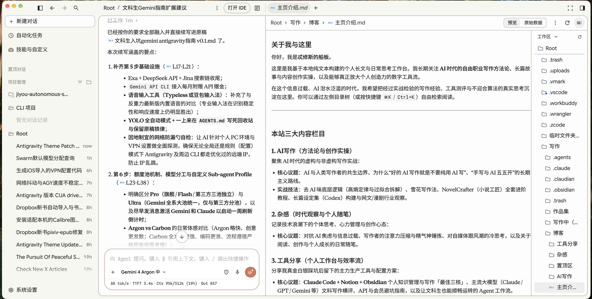
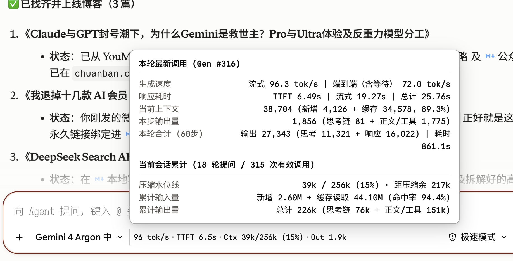

# 船板的 Antigravity 主题、字体与汉化补丁 (v5.5.0)

[-339933.svg)](https://nodejs.org/)

面向 Google Antigravity（支持最新 **`2.33.0+`**）的非侵入式运行时补丁：提供书卷暖纸与双深色预设、四层中西文排版、1,860 条界面汉化与 SQLite 实时会话遥测胶囊。不修改客户端 `.asar` 与系统签名，零第三方 npm 依赖，由 AI Agent 一键部署并通过 `user/` 层实现 `2.5s` 热重载定制。

> 供 AI Agent 读取的完整部署与改装技术契约位于仓库根目录 **[`SKILL.md`](https://github.com/Anarcadia/chuanban-antigravity-theme-patch/blob/main/SKILL.md)**。

---

## 🔗 资源入口

| 入口 | 地址 | 说明 |
| :--- | :--- | :--- |
| **1. Google Drive 资源包（含字体）** | [**Google Drive 共享文件夹**](https://drive.google.com/drive/folders/1NX92SgVUqtSjWg6bt6sIJXy-cn7J_boC) | 含成品包与 4 个必备字体文件：`AnthropicSerif-Regular/Bold.ttf`、`AnthropicMono-Regular.ttf`、`Sarasa-SuperTTC.ttc`（`v5.5.0` UI 西文已直连官方 `Google Sans Flex`，无需 `AnthropicSans`）。若 `Sarasa-SuperTTC.ttc` 遇网盘 24h 下载限流，macOS 可用 `brew install --cask font-sarasa-gothic`，Windows/Linux 可从 [`be5invis/Sarasa-Gothic` Releases](https://github.com/be5invis/Sarasa-Gothic/releases) 获取。 |
| **2. GitHub 代码仓库** | [**Anarcadia/chuanban-antigravity-theme-patch**](https://github.com/Anarcadia/chuanban-antigravity-theme-patch) | 包含预封装内核 `core/`、个人改装层 `user/`、生命周期 CLI `install.mjs` 与 [`SKILL.md`](https://github.com/Anarcadia/chuanban-antigravity-theme-patch/blob/main/SKILL.md)（字体请从上方 Google Drive 获取）。 |
| **3. Notion 引导页** | [**chuanban-antigravity-theme-patch**](https://chuanban.notion.site/chuanban-antigravity-theme-patch-db7c5846f37546be9481cd791aed0554) | 图文说明与安装引导镜像页。 |

---

## 🖼️ 实机效果

### 1. 标准浅色主界面：高对比书卷暖白工作台 + 衬线正文与活字润墨 + 暗红蜡封输入框
> 左侧 `#F7F5F0` 暖燕麦侧栏（`Google Sans Flex` × 更纱黑体 UI 字重桥接）+ `#FCFCFB` 微暖亮白对话区与 Markdown 预览（`Anthropic Serif` × `Sarasa Mono Slab SC` 衬线）+ 底部 `1.5px` 暗红蜡封输入框与同行实时指标胶囊。

### 2. 黑夜界面效果：Claude 暖纸深夜模式（`claude-warm`）+ 代码审阅 Diff 视图
> `#242320` 暖炭底色 + `#1B1A18` 深炭侧栏 + `#F3F0E4` 象牙白正文 + `#D97757` 陶土暖橙点缀；在「系统设置 → 外观界面」点击 **📖 / 🌙** 按钮即可在「暖纸深夜」与「官方冷碳黑（`onyx`）」之间 `0ms` 切换并自动持久化。

### 3. 上下文对话信息胶囊与悬停遥测详情卡
> 嵌入输入框底栏的实时指标胶囊（支持多路平铺分屏、`/btw` 支线提问与子 Agent 侧栏独立计量）；悬停展开本轮流式/端到端 `tok/s`、`TTFT`、思考链与正文输出拆分，以及当前会话累计压缩水位线与缓存命中率。

---

## ✨ 核心特性（v5.5.0）

- **昼夜双模式与四套配色预设**：浅色内置高对比暖白（默认）、ClaudeDesktop 净白、复古羊皮纸三套暖纸预设及 macOS 浅色全域活字润墨；深色在客户端外观面板原生嵌入 **📖 书卷按钮**（`[ 🖥️ | ☀️ | 📖 | 🌙 ]`），一键切换官方碳黑（`onyx`）或 Claude 暖纸深夜（`claude-warm`），自动同步 Windows 原生标题栏、启动幕布与 `Swarm` 协作子帧。
- **四层中西文排版与字重桥接**：UI 西文直连官方 `Google Sans Flex` 可变字体引擎（`wght 350–650`, `wdth 92`，内置 `#ag-google-sans-flex-fonts` 防脱靶保底），中文经 `AgSarasaUI` 精确映射更纱黑体字重（消除 `350` 字重落入 `Light` 发虚与 Windows `FontLink` 微软雅黑替换）；对话正文与 Markdown 保持 `Anthropic Serif` + `Sarasa Mono Slab SC` 衬线（含 Windows `DirectWrite` 子节点 `wght 400/500/600` 还原）；代码与终端采用 `Anthropic Mono` 等宽；主输入框采用打字机板状粗衬线配三态蜡封边框。
- **1,860 条界面汉化与代码区严格隔离**：覆盖主界面、15+ 设置子页、快捷键方案、内置浏览器管理、`Swarm` 蜂群面板与模型档位动态文案；全词表通过大小写与弯直引号零碰撞校验，基于 `WeakMap` 追踪英文原词支持热还原，严格隔离代码块、Monaco 编辑器、终端及英文历史对话标题。
- **SQLite `O(1)` 增量实时指标胶囊**：基于 Node.js `>= 22.13` 原生 `node:sqlite` 增量游标（兼容本地会话库与 Windows WSL2 默认发行版双轨只读读取），在分屏、`/btw` 与子 Agent 标签页各自独立展示 `tok/s`、`TTFT`、动态识别的真实模型上下文上限（`256k`–`1M+`）、子 Agent 全树消耗汇总（`+N sub`）与缓存命中率。
- **零侵入单图标启动接力与 `2.5s` 热重载架构**：针对 Antigravity `2.33.0+` 默认移除调试端口的变更，保持双端**唯一官方原版图标**（Windows/Linux 原地幂等修补快捷方式参数，全平台守护进程在冷启动 `<=12s` / 更新重启 `<=25s` 自动无感补挂 `--remote-debugging-port=0`，对存量活跃会话 100% 豁免保护），并通过宿主独占指纹门禁豁免内置浏览器本地预览页；`core/` 只读内核与 `user/` 个人配置层物理分离，升级不覆盖个人修改，修改 `user/*` 保存后 `2.5s` 自动热生效。

---

## 🚀 安装、升级与日常定制

### 一、新用户首次安装
1. **环境准备**：安装 **Node.js `>= 22.0.0`**（推荐 **`>= 22.13.0`** 以启用实时指标胶囊），并从 [**Google Drive 资源包**](https://drive.google.com/drive/folders/1NX92SgVUqtSjWg6bt6sIJXy-cn7J_boC) 下载上述 4 个字体文件（可先放在下载目录，直接让下方 Agent 一键完成注册安装）。
2. **复制以下引导词发给你的 AI Agent（Antigravity / Claude Code / Codex / Cursor 等）**：

> **💬 复制发给 Agent（新用户一键安装）**：  
> 请帮我克隆 `https://github.com/Anarcadia/chuanban-antigravity-theme-patch.git`（或读取我已下载解压的补丁目录），先完整阅读仓库内的 `SKILL.md`，再按以下顺序部署并处理边缘情况：  
> 1. 若本机有 `nvm` / `fnm` / `volta`，优先切换至 `Node >= 22.13.0` 执行命令；运行 `node install.mjs doctor` 检查 `fonts.allRequiredInstalled`。  
> 2. 若缺少字体（需 `Anthropic Serif`、`Anthropic Mono`、`Sarasa-SuperTTC.ttc`）：先在我刚下载的目录中查找并用 `node install.mjs install-fonts --from <字体目录>` 一键安装（Windows 下必须用此命令写入注册表，勿仅手动复制文件；若缺 `Sarasa-SuperTTC.ttc` 且遇网盘限流，macOS 可直接执行 `brew install --cask font-sarasa-gothic`，Windows/Linux 引导我从 `be5invis/Sarasa-Gothic` Releases 下载）。  
> 3. 运行 `node install.mjs install` 完成安装（注：macOS 默认单图标模式 `launcherInstalled: false` 属正常设计）。  
> 4. 检查输出中的 `cdpStatus`：若为 `"missing_opt_in_flag"`（Antigravity `2.33.0+` 尚未挂调试端口），**如果你当前正在 Antigravity 内部对话中运行，请勿执行 `--force` 强行重启自断会话**，只需把空闲时执行的命令 `node ~/.gemini/antigravity/theme-patch/install.mjs relaunch`（Windows 为 `node "$HOME\.gemini\antigravity\theme-patch\install.mjs" relaunch`，或提示我直接手动退出重开一次 Antigravity）发给我；如果你在外部独立终端运行且客户端空闲，请直接执行 `node install.mjs relaunch`。  
> 5. 在端口就绪后运行 `node install.mjs verify`，确认 `"ok": true` 且 `"hasStyle": true` 即完成验收。

### 二、老用户升级至 v5.5.0
`node install.mjs install` 会自动备份旧版 `core/` 内核、更新系统常驻服务，并完整保留 `~/.gemini/antigravity/theme-patch/user/` 中的个人配置：

> **💬 复制发给 Agent（老用户无缝升级）**：  
> 请帮我拉取最新的 `https://github.com/Anarcadia/chuanban-antigravity-theme-patch.git`（或读取最新解压目录），阅读其中的 `SKILL.md` 后直接运行 `node install.mjs install` 升级至 `v5.5.0`（若我此前使用的是更早期的单文件版 `antigravity-font-daemon.mjs` 且有自定义字号/配色，请先帮我把自定义项迁移到 `~/.gemini/antigravity/theme-patch/user/`）。若安装后 `cdpStatus` 为 `"missing_opt_in_flag"` 且你正在 Antigravity 内部会话中运行，请勿直接中断当前对话，告诉我空闲时运行 `node ~/.gemini/antigravity/theme-patch/install.mjs relaunch`（或手动重开一次客户端）即可；端口已就绪则直接运行 `node install.mjs verify` 验收。

### 三、后续个性化调整与排障话术
- **🎨 切换昼夜预设、调整字号或微调样式**：
  > 请按 `~/.gemini/antigravity/theme-patch/SKILL.md` 规范，仅修改 `user/` 目录下的配置文件：把白天预设改为 `"claude-desktop-purewhite"`（或 `"vintage-deep"`） / 把黑夜预设 `"darkPreset"` 改为 `"claude-warm"` / 把对话正文字号 `"--ag-chat-font-size"` 调为 `"16.5px"`。
- **🇨🇳 自定义修改或补充汉化词条**：
  > 请在 `~/.gemini/antigravity/theme-patch/user/i18n.override.json` 中新增或覆盖词条 `"英文原词": "自定义中文"`，确认 2.5 秒内页面实时热更新生效。
- **🔍 故障定界与一键回滚**：
  > 请按 `~/.gemini/antigravity/theme-patch/SKILL.md` 依次运行 `node install.mjs doctor` 和 `node install.mjs verify --safe-mode` 排查是否为 `user/` 自定义层冲突；如需退回上一版本请运行 `node install.mjs rollback`。
  - *注：若客户端冷启动后偶发未显示 `Remote`（远程）入口，属官方 `language_server` 冷启动兜底包竞态（补丁已内置空输入态自动自愈；若启动瞬间正在输入触发了草稿保护，按 `Cmd/Ctrl + Shift + R` 刷新一次即可恢复）。*

---

## 🕒 版本演进（完整记录见 [`CHANGELOG.md`](CHANGELOG.md)）

- **v5.5.0（2026-11-19 · 现行版）**
  - 适配 **Antigravity `2.33.0`**（macOS × Windows 11 双端真机验收）：落地单图标纯净模式 + `M1 + M2` 零侵入 CDP 启动接力（Windows `.lnk` / Linux `.desktop` 原地幂等打标、macOS 默认单图标零冗余、`relaunch` 子命令、冷启动 `<=12s` / 更新重启 `<=25s` 自动补参接力、Windows `0.02ms` 内存级空闲短路、`sidecar_sdk` 伴生进程过滤及活跃会话 100% 保护）与 `doctor` `missing_opt_in_flag` 诊断；UI 西文切换至官方 `Google Sans Flex` 可变字体引擎（含 `#ag-google-sans-flex-fonts` 防脱靶保底）× `AgSarasaUI` 更纱黑体字重桥接，保留正文 `Anthropic Serif`（含 Windows `DirectWrite` 子节点 `wght 400/500/600` 还原）；新增 macOS 浅色全域活字润墨与 UI 字重微平衡（Windows 零改动）；补齐无 `data-newux-theme` 选择器并将词典扩充至 `1,860` 条。
- **v5.4.3（2026-11-18）**
  - 适配 Antigravity `2.32.2` 与 `Gemini 4 Carbon` 模型矩阵（词典 `1,790` 条）；新增多路平铺分屏、`/btw` 支线提问与子 Agent 侧栏标签页独立实时指标胶囊及窄分屏动态折行（合入 [@CaramelizedCUDA](https://github.com/CaramelizedCUDA) [#17](https://github.com/Anarcadia/chuanban-antigravity-theme-patch/pull/17) 修复 [#16](https://github.com/Anarcadia/chuanban-antigravity-theme-patch/issues/16)）；加固 Swarm 子帧 `darkPreset` `<1ms` 瞬时同步、修复 `coldBootHealer` 二次复检自锁、隔离英文历史对话标题，并升级 macOS 中文标题外挂悬浮告警卡「一键复制修复命令」与守护日志自截断保护。
- **v5.4.2（2026-11-17）**：打通主窗口至 `plugin://swarm--` 子帧的实时深浅色中继与零闪白预置，消除双向切换下的子帧主题失步（[#15](https://github.com/Anarcadia/chuanban-antigravity-theme-patch/pull/15)）。
- **v5.4.1（2026-11-17）**：在「系统设置 → 外观界面 → 主题模式」胶囊中嵌入原生 **📖 书卷按钮**，支持 `0ms` 一键切换「Claude 暖纸深夜」并自动落盘记忆。
- **v5.4.0（2026-11-16）**：新增 `claude-warm` 暖纸深夜预设（[#13](https://github.com/Anarcadia/chuanban-antigravity-theme-patch/issues/13)）、内置浏览器本地预览页豁免门禁（[#12](https://github.com/Anarcadia/chuanban-antigravity-theme-patch/pull/12)）、Windows WSL2 SQLite 双轨只读读取（[#10](https://github.com/Anarcadia/chuanban-antigravity-theme-patch/issues/10)）与中完整性计划任务自启锁（[#8](https://github.com/Anarcadia/chuanban-antigravity-theme-patch/issues/8)）。
- **v5.3.0（2026-11-15）**：支持子 Agent 全树消耗汇总 `+N sub`（[#7](https://github.com/Anarcadia/chuanban-antigravity-theme-patch/pull/7)）、动态识别模型真实上下文窗口上限（[#6](https://github.com/Anarcadia/chuanban-antigravity-theme-patch/pull/6)），并完成 `2.32.1` 双平台适配（`1,740` 条词典）。
- **v5.2.0（2026-11-14）**：适配 Antigravity `2.32.0`，完成全词库系统性去机翻重构与 6 项核心术语统一（`1,630` 条）。
- **v5.1.8（2026-11-14）**：新增冷启动内嵌兜底包零流量安全自愈机制，解决偶发丢失 `Remote` 远程入口问题。
- **v5.1.6（2026-11-13）**：适配 Antigravity `2.31.2`，打通 `Swarm` 子帧注入、原生幕布底色同步与防双倍缩放。
- **v5.1.3（2026-11-11）**：适配 Antigravity `2.31.0`，将 SQLite 指标读取与 DOM 汉化升级为 `O(1)` 增量引擎。
- **v5.1.0（2026-11-10）**：确立浅色暖纸预设与深色官方碳黑物理隔离的昼夜双模式架构。
- **v5.0.0（2026-11-04）**：确立「`core/` 只读内核 + `user/` `2.5s` 热重载改装层 + `install.mjs` 一键 CLI」模块化架构。
