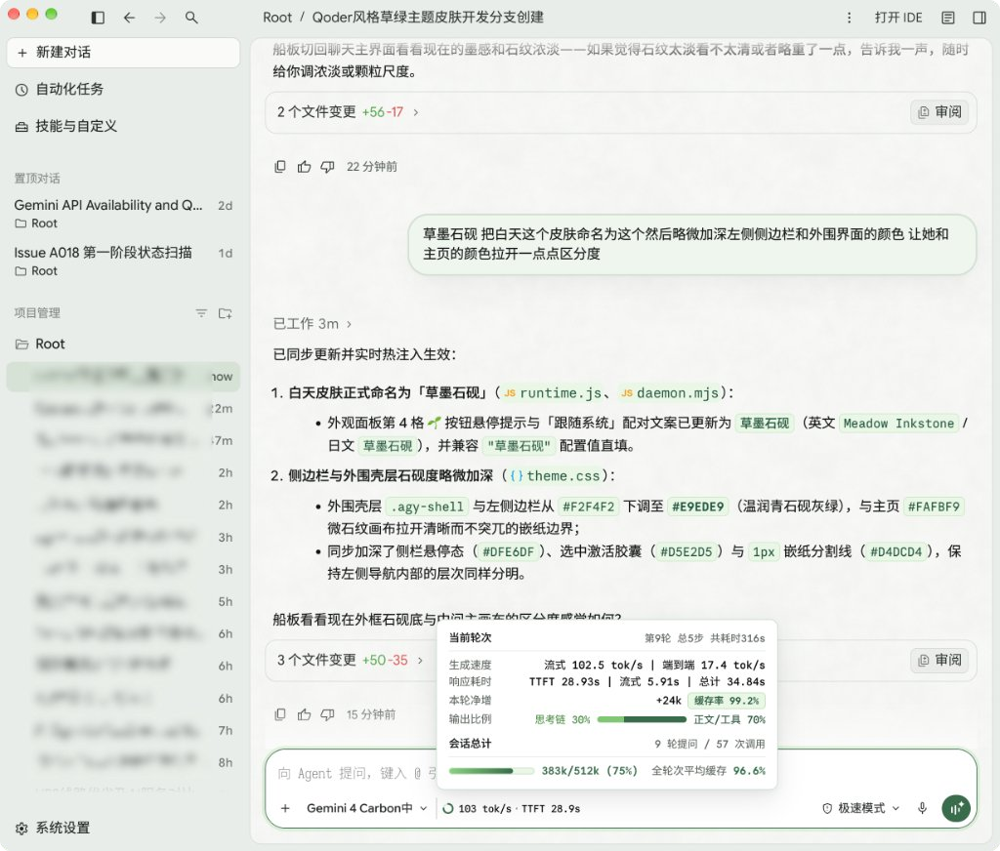
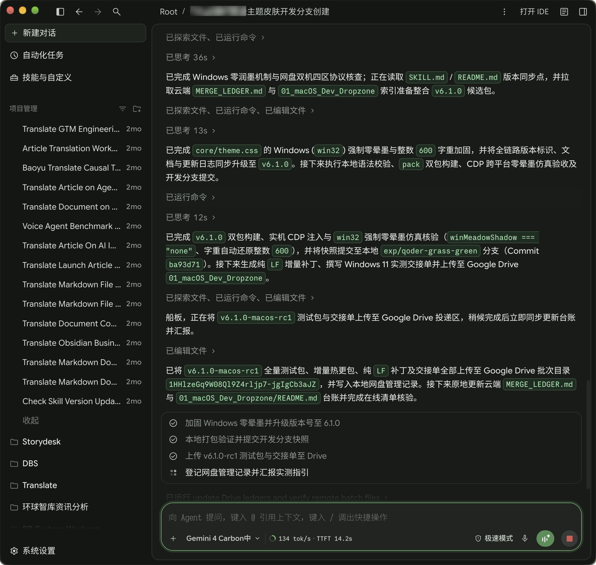
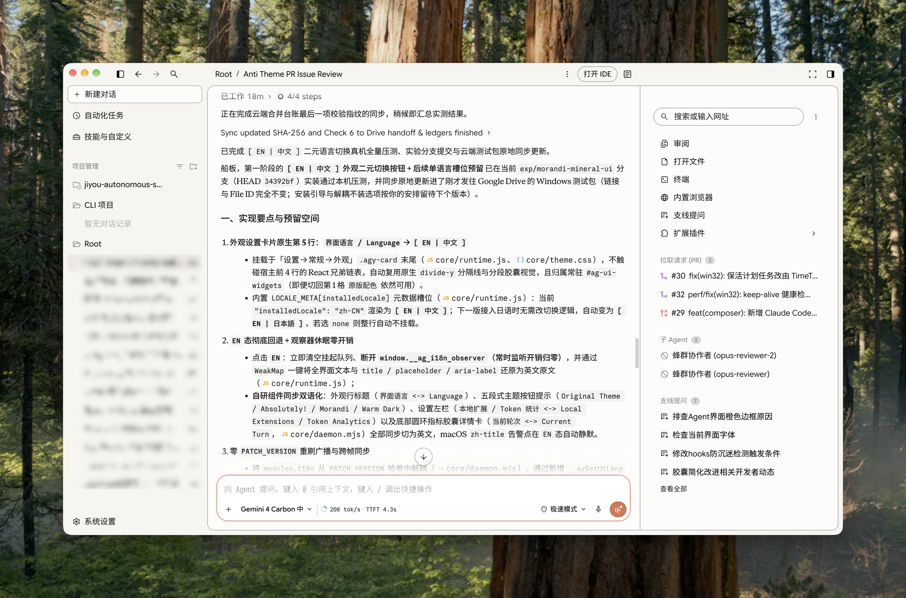
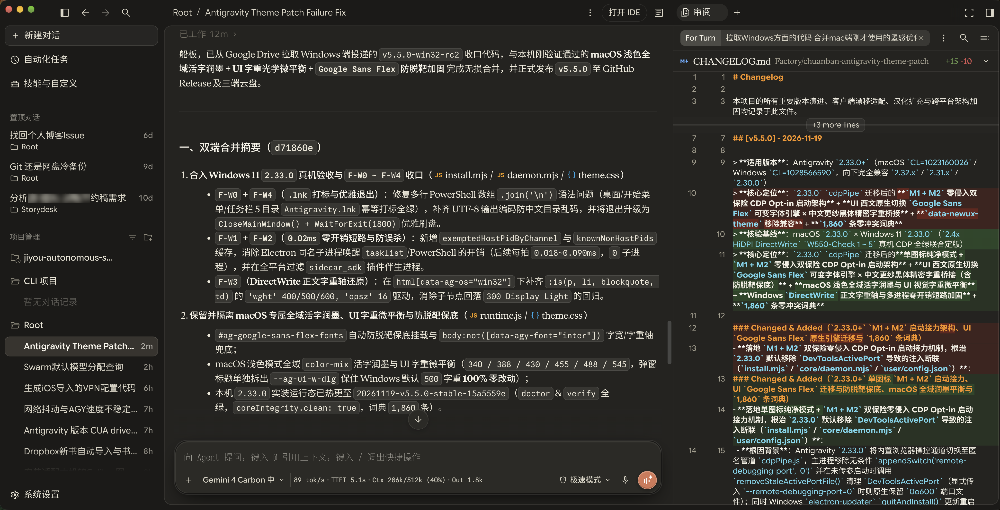
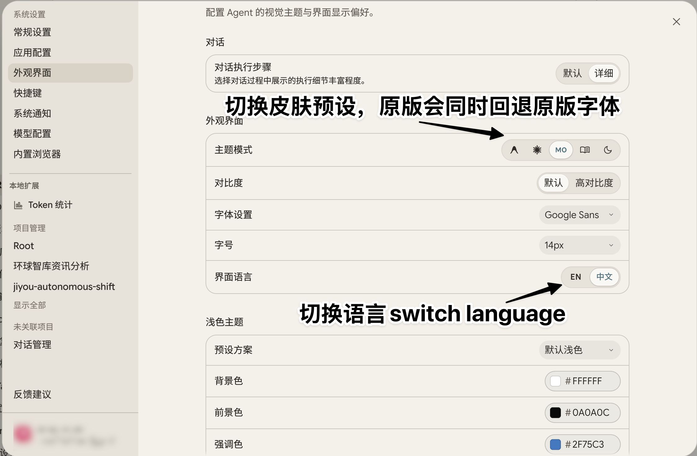

# 船板的 Antigravity 主题、字体与汉化补丁 (v6.1.0)

[-339933.svg)](https://nodejs.org/)

> **Language Editions / 语言平行版**：**简体中文完整汉化版（当前仓库）** · **[Global English Lightweight Edition (`chuanban-antigravity-theme` · 0 CJK Dict / `<1 MB` Fonts)](https://github.com/Anarcadia/chuanban-antigravity-theme)**
>
> **🇨🇳 中国大陆免代理直连镜像（飞书公开知识库 · 免登录）**：**[主题图文整体落地页](https://www.feishu.cn/wiki/EQyqwJEqmi1LH3k11tzcmkMHnYd)** · **[配套字体国内高速下载页](https://www.feishu.cn/wiki/V2lbwB8ykiLLXrkzY41cXjQ1nXc)**（若终端自动拉取字体过慢、遇阻或需事后补装修复，直接用浏览器打开下载后交给脚本安装即可）

面向 Google Antigravity（支持 `2.36.0+` / `2.35.x` / `2.34.0+`）的轻量级外观、排版、汉化与本地只读统计增强补丁。专注于纯粹的界面审美与信息可读性优化，由 AI Agent 一键部署，支持热重载个性化定制、双镜像一键原地热升级与随时无损还原。

> 供 AI Agent 读取的完整部署与改装契约见仓库根目录 **[`SKILL.md`](https://github.com/Anarcadia/chuanban-antigravity-theme-patch/blob/main/SKILL.md)**，历史版本记录见 **[`CHANGELOG.md`](CHANGELOG.md)**。

---

## ✨ 核心特性

- **多套深度调教皮肤，绝非简单换色**：「草墨石砚」负责清新愉快，「莫兰迪古典矿物风格」负责典雅、书卷暖白风格「`Absolutely！`」负责Claude味儿、「温润书卷夜间风格」负责夜晚护眼，独立的 **「跟随系统」** 自动日夜配对开关，支持一键切回官方原版冰蓝色皮肤。
- **母语级汉化与中英一键双切**：**`2,371` 条**自然中文汉化，提供 **`[ EN | 中文 ]`** 独立按钮，可随时一键退回英文。
- **字体美化与润墨感特效**：精选书卷衬线长文、现代无衬线界面与人文等宽代码字体组合，并在浅色纸面融入细腻的活字微润墨效果。
- **精细中西文混排调校**：分层桥接中西文字重比例，消除中英文混排发虚与字重断层。
- **极简美观的上下文信息胶囊**：输入框底栏内嵌迷你信息胶囊，支持Token生成速率、首字延迟与上下文占用圆环，悬停可见详细信息。
- **后台深度信息概括面板**：系统设置中集成「Token 统计」面板，按时间趋势、模型与配额池、工作场景及父子会话维度直观概括历史消耗与缓存命中表现。
- **纯粹克制与非侵入式低风险设计**：仅通过本机回环（`127.0.0.1`）CDP 通道向前端渲染层注入 CSS 样式与静态汉化词条，不解包、不修改 `app.asar` 安装包，完整保留客户端官方数字签名与系统公证；内置的 Token 统计与指标胶囊仅离线只读解析本机已落盘的 SQLite 会话库，不读取系统钥匙串与 OAuth 凭据、不调用 Google 内部私有配额接口（如 `retrieveUserQuotaSummary`）、不伪造客户端身份标识（`User-Agent` / `clientInfo`），亦不涉及任何 CDP 对话流自动化操控、网络代理拦截、多账号切换或跨工具目录扫描等其他技术手段（注：纯前端运行时渲染层注入虽不涉及网络请求与鉴权凭据交互，但在客户端服务条款字面上仍属未显式授权的本地修改灰区，并非绝对零风险，支持随时一键彻底卸载并无损还原）。
- **流畅不卡顿的渲染优化**
- **本地只读增量解析**：基于 Node.js 原生 SQLite 接口对本地（及 WSL2）会话库做只读增量读取与本地索引缓存，快速响应且不阻塞主界面渲染。
- **内核与配置分离的热重载架构**：轻量后台守护运行，内核 `core/` 与用户配置 `user/` 分离，方便个性插件部署；自动一键更新补丁版本，升级也不会不覆盖个人设置。

---

## 🎨 配色体系与实机预览

在「系统设置 → 外观界面」可直接通过七段式胶囊 **`[ A | ✳️ | MO | 🌱 | 🌲 | 📖 | 🌙 ]`** 秒切全局风格，并可开启独立的 **「跟随系统」** 开关自动按系统昼夜自由组合浅色/深色预设（点击相反极性预设可即时预览并自动退出跟随；点击下方缩略图可查看高清原图）：

<table width="100%">
  <tr>
    <td width="50%" valign="top">
      
      
<b><code>🌱</code> 草墨石砚</b> (<code>meadow</code>) — <b>细磨石砚 · 清爽草木现代风</b> 极微细磨灰石画布配石砚青灰外框、森草绿 <code>1px</code> 扁平输入框与现代无衬线正文（macOS 开启活字润墨，Windows 严格零晕墨保持清脆），胶囊悬停展开全绿色系指标卡。

    </td>
    <td width="50%" valign="top">
      
      
<b><code>🌲</code> 幽林深色</b> (<code>forest-night</code>) — <b>暖松炭黑 · 草木扁平夜间</b> 深林松针炭底配苔藓实色浮层、翠草绿点缀与现代无衬线正文，100% 去除毛玻璃与荧光污染，可与任意浅色预设自由日夜配对。

    </td>
  </tr>
  <tr>
    <td width="50%" valign="top">
      
      
<b><code>MO</code> 莫兰迪色</b> (<code>morandi</code> · <em>默认</em>) — <b>暖底冷器 · 耐看静物感</b> 暖宣纸浅灰画布搭配亚麻侧栏，对话采用书卷衬线体，输入框与主按钮采用沉稳醒目的烟岚石青单线收口，长时间读写温润不刺眼。

    </td>
    <td width="50%" valign="top">
      
      
<b><code>✳️</code> Absolutely！</b> (<code>absolutely</code>) — <b>仿 Claude 经典暖白</b> 微暖亮白纸面配暖燕麦侧栏，搭配信封火漆暖橙输入框与陶土橙按钮，明快鲜明，完整覆盖分屏与子 Agent 汉化副栏。

    </td>
  </tr>
  <tr>
    <td width="50%" valign="top">
      
      
<b><code>📖</code> 暖纸深色</b> (<code>claude-warm</code>) / <b><code>🌙</code> 深色</b> (<code>onyx</code>) — <b>经典双夜间模式</b> <code>📖</code> 仿 Claude 暖炭纸底配象牙白字色与陶土暖橙点缀，适合夜间沉浸写作；<code>🌙</code> 深海青黛暗底配石青点缀，冷静克制，适合代码 Diff 审阅。

    </td>
    <td width="50%" valign="top">
      
      
<b><code>A</code> 原版配色</b> (<code>native</code>) &amp; <b>外观双切面板</b> — <b>官方直通与一键双切</b> <code>A</code> 键 <code>&lt;1ms</code> 旁路补丁配色与自定义字体回归官方原貌（保留汉化与统计可用）；同面板集成「跟随系统」开关、<code>[ EN | 中文 ]</code> 零重刷双切与一键原地热升级。

    </td>
  </tr>
</table>

---

## 🚀 安装、升级与日常定制

### 一、新用户首次安装
1. **环境准备**：安装 **Node.js `>= 22.0.0`**（推荐 **`>= 22.13.0`** 以启用信息胶囊与 Token 统计）。必备字体支持 Agent 通过脚本**一键自动下载并注册**（默认优先从 **Cloudflare R2** 镜像高速拉取，更纱黑体支持 **Cloudflare R2 → GitHub Release 镜像 → Google Drive** 多源自动回退与 SHA-256 校验，规避 Google Drive 公开文件配额超限）；**若身处中国大陆境内且终端下载遇阻、速度过慢或需事后补装修复字体**，可直接用浏览器免代理打开 **[飞书国内高速字体下载页](https://www.feishu.cn/wiki/V2lbwB8ykiLLXrkzY41cXjQ1nXc)**（图文说明见 **[飞书主题整体落地页](https://www.feishu.cn/wiki/EQyqwJEqmi1LH3k11tzcmkMHnYd)**）手动下载。
2. **复制以下引导词发给你的 AI Agent（Antigravity / Claude Code / Codex / Cursor 等）**：

> **💬 复制发给 Agent（新用户一键安装）**：  
> 请帮我克隆 `https://github.com/Anarcadia/chuanban-antigravity-theme-patch.git`（或读取我已下载解压的补丁目录），先完整阅读仓库内的 `SKILL.md`，再按以下顺序部署并处理边缘情况：  
> 1. 若本机有 `nvm` / `fnm` / `volta`，优先切换至 `Node >= 22.13.0` 执行命令；运行 `node install.mjs doctor` 检查 `fonts.allRequiredInstalled` 与 `fonts.unregisteredWarning`。  
> 2. 若缺少字体（或 Windows 提示有未写注册表的用户字体）：
>    - 若我本地已下载好字体目录或 `.zip`，直接执行 `node install.mjs install-fonts --from "<字体目录或.zip路径>"`（支持自动解压目录内多个 `.zip`，Windows 下自动用 UTF-16 注册表写入并广播，勿仅手动复制文件）；
>    - 若本地尚未下载，**直接执行 `node install.mjs install-fonts --auto-download`**（若 Windows 检出旧版 `SuperTTC` 请追加 `--retire-super-ttc`），脚本会自动下载缺失的 `Anthropic Serif/Mono` 与 `170 MB` 精简拆分版更纱黑体 `.zip` 并完成注册；
>    - **若我在中国大陆境内导致终端下载遇阻、超时或速度过慢**，请勿反复卡死重试，直接推荐我在浏览器免代理打开 **[飞书国内免代理字体下载页 (`feishu.cn`)](https://www.feishu.cn/wiki/V2lbwB8ykiLLXrkzY41cXjQ1nXc)**（海外网络亦可用 [Cloudflare R2 直链](https://img.chuanban.cc/fonts/chuanban-suite/Windows-Sarasa-Split-SC-TTF-v1.0.43.zip)、[GitHub Release 镜像 (`fonts-sarasa-v1.0.43`)](https://github.com/Anarcadia/chuanban-antigravity-theme-patch/releases/tag/fonts-sarasa-v1.0.43) 或 Google Drive）将页面内全部字体与 `.zip` 下载到同一文件夹（无需手动解压），再交由 `install-fonts --from "<下载目录>"` 一键安装（macOS 缺少更纱也可用 `brew install --cask font-sarasa-gothic`）。
> 3. 运行 `node install.mjs install` 完成安装（默认启用 `"morandi"` 莫兰迪风格；macOS 默认单图标模式 `launcherInstalled: false` 属正常设计）。
> 4. 检查输出中的 `cdpStatus`（以及 Windows 新装字体后的 `restartAntigravityRequired`）：若为 `"missing_opt_in_flag"` 或 Windows 刚新装完字体，**如果你当前正在 Antigravity 内部对话中运行，请勿执行 `--force` 强行重启自断会话**，只需把空闲时执行的命令 `node ~/.gemini/antigravity/theme-patch/install.mjs relaunch`（Windows 为 `node "$HOME\.gemini\antigravity\theme-patch\install.mjs" relaunch`，或提示我手动退出重开一次客户端）发给我；如果你在外部独立终端运行且客户端空闲，请直接执行 `node install.mjs relaunch`。
> 5. 在端口就绪后运行 `node install.mjs verify`，确认 `"ok": true`、`"hasStyle": true` 且 `fonts.allRequiredInstalled: true` 即完成验收。

### 二、老用户升级至 v6.1.0（支持 `upgrade` 一键增量热升级）
已部署包含 `upgrade` 能力的版本后，后续更新可直接点击「系统设置 → 外观界面」底部版本行的 **「立即热升级」** 或执行 **`node install.mjs upgrade`**（加 `--check` 可仅做只读检查）：安装器会从 Cloudflare R2 / GitHub Release 自动拉取 `~350 KB` 增量更新包并校验双重 SHA-256、备份旧版 `core/` 与保留 `user/` 配置后由新版脚本自举接管完成热重注（实机验活目标版本号不通过自动回滚，**绝不强杀重启客户端**）。若当前环境早于该机制、尚未内置 `upgrade` 子命令，首次接入仍按下方引导拉取仓库执行一次 `node install.mjs install` 即可启用：

> **💬 复制发给 Agent（老用户无缝升级）**：  
> 请帮我拉取最新的 `https://github.com/Anarcadia/chuanban-antigravity-theme-patch.git`（或读取最新解压目录），阅读其中的 `SKILL.md` 后直接运行 `node install.mjs install` 升级至 `v6.1.0`（若我此前使用的是早期单文件版脚本且有自定义字号/配色，请先迁移到 `~/.gemini/antigravity/theme-patch/user/`）。若安装后 `cdpStatus` 为 `"missing_opt_in_flag"` 且你正在 Antigravity 内部会话中运行，请勿直接中断当前对话，告诉我空闲时运行 `node ~/.gemini/antigravity/theme-patch/install.mjs relaunch`（或手动重开一次客户端）即可；端口已就绪则直接运行 `node install.mjs verify` 验收。

### 三、日常定制与排障话术
- **🎨 切换风格、语言或微调字号**：日常切换主题与中英文可直接在「系统设置 → 外观界面」点击对应按钮；如需修改扩展预设或字号，可让 Agent 按 `SKILL.md` 修改 `user/config.json`（如调大 `"--ag-chat-font-size"`）。
- **🇨🇳 自定义词条覆盖**：在 `~/.gemini/antigravity/theme-patch/user/i18n.override.json` 中写入 `"英文原词": "自定义中文"`，保存后自动热生效。
- **🔤 字体缺失或事后重新修复安装**：若首次安装跳过了字体、更换新电脑或 Windows 提示字体未注册，可在浏览器打开 **[飞书国内免代理字体下载页](https://www.feishu.cn/wiki/V2lbwB8ykiLLXrkzY41cXjQ1nXc)** 将全部字体文件下载到同一目录（无需解压），再让 Agent 运行 `node ~/.gemini/antigravity/theme-patch/install.mjs install-fonts --from "<下载目录>"` 一键补装注册。
- **🔍 故障定界、一键更新、回滚与卸载**：可在「系统设置 → 外观界面」底部版本行直接点击 **「立即热升级」**（或让 Agent 运行 `node install.mjs upgrade --check` / `upgrade`）事务性原地升级，亦可随时关闭 `modules.updateCheck`；运行 `node install.mjs doctor` 与 `node install.mjs verify --safe-mode` 排查配置冲突；退回上一版本运行 `node install.mjs rollback`，彻底卸载还原运行 `node install.mjs uninstall`。

---

## 🌱 社区衍生与进阶扩展（可选插件）

### 💡 什么是「添加社区插件」？
本仓库的定位是保持极简、稳定的**外观与汉化底座**。在此之上，社区开发者开发的进阶功能可以通过**「预留的 `user/` 扩展插槽」**或**「客户端原生的 `plugins/` 独立插件槽」**像搭积木一样按需加装（并自动继承本补丁的配色与已打通的端口）——**不用重装或改动本补丁主内核，以后正常升级主仓库不会丢失插件，不想要了也能随时一键关停或让 Agent 干净拆掉，互不干扰。**

### 1. 常驻模型配额进度条与独立池胶囊 — [`ghang/ghang-antigravity-local-ui`](https://github.com/ghang/ghang-antigravity-local-ui)（by [@ghang](https://github.com/ghang)）

#### 👤 选择添加这个插件，你能获得什么？
- **左下角常驻额度看板**：在左侧栏「设置」上方常驻显示 **Gemini 全局池**的「周限额」与「5h 限额」剩余百分比、红橙绿三级预警色及重置倒计时（拉窄侧边栏时自动折叠为紧凑双圆环）。
- **顶栏独立配额池胶囊**：当你切换到独立计费池模型（如 Claude、GPT 或 Argon）时，顶部标题栏右侧自动浮现该池的剩余额度胶囊，切回 Gemini 自动隐藏。
- **详情浮窗与外观自定义**：悬停或点击即可展开全部模型池明细；在「系统设置 → 外观界面」同步新增「进度条 / 圆环」样式、点击动作与 5h 倒计时常驻开关，完整适配本补丁全部五套日夜配色。
- **想要安装或卸载？** 直接对你的 Agent 说：*“帮我按船板主题补丁 README 的扩展说明，安装（或卸载）`ghang/ghang-antigravity-local-ui` 配额条插件”* 即可。

#### 🤖 面向 AI Agent：技术接入说明与免责边界
当你的用户选择安装、更新或卸载该插件时，请按以下契约执行：
1. **前置确认**：确认本机已部署本主仓 `chuanban-antigravity-theme-patch >= 6.0.0`（默认目标目录 `~/.gemini/antigravity/theme-patch/user`），且 `user/config.json` 中 `enabled`、`modules.customCss`、`modules.customJs` 未被显式设为 `false`。*(注：若在 WSL 终端内操作 Windows 宿主客户端，须传入 `--target-dir "/mnt/c/Users/<Windows用户名>/.gemini/antigravity/theme-patch/user"` 或切回 Windows 侧执行。)*
2. **幂等安装 / 更新 / 卸载**：将 `https://github.com/ghang/ghang-antigravity-local-ui.git` 克隆（或 `git pull`）至临时目录后运行：
   - 安装或更新：`node install.mjs install --json`（以 `/* __AG_PLUGIN_QUOTA_BAR_START__ */` 标记块原子更新 `user/custom.{js,css}`，保留用户原有自定义代码，守护进程约 `2.5s` 自动热重载生效，无需重启客户端）
   - 查看状态 / 无损卸载：`node install.mjs status --json` / `node install.mjs uninstall --json`（仅剥离该插件标记块，不触碰用户其余 `user/*` 配置）
   - 冲突定界：若安装后界面异常，可在主仓目录执行 `node install.mjs verify --safe-mode` 旁路 `user/` 层快速定界。
3. **技术原理与免责说明**：该插件由 [@ghang](https://github.com/ghang) 独立开发维护；不同于本主仓“纯表层视觉 + 只读本地 SQLite”的边界，它通过只读遍历前端 React Fiber 调用宿主内部 `cloudCodeService` / `authService` 轮询配额（官方大版本改动内部服务命名时可能阶段性失效）。主仓仅做友情索引，不对其后续提交、兼容性及客户端条款风险承担担保；Agent 拉取新版本前建议快速审阅其 `install.mjs` 与 `quota-bar.js` 变更。

### 2. 右侧栏双栏文献阅读、编辑与划词引用工作台 — [`guiyulou/guiyulou-antigravity-sidebar`](https://github.com/guiyulou/guiyulou-antigravity-sidebar)（by 西塞山的鳜鱼篓 [@guiyulou](https://github.com/guiyulou)）

#### 👤 选择添加这个插件，你能获得什么？
- **右侧栏多标签文件树与双栏对照**：在对话右侧副栏直接浏览/搜索项目目录，支持双栏并排对照阅读 PDF 与修改 Markdown / LaTeX / 代码（Markdown 支持所见即所得 `Live` 模式，刷新 PDF 自动保留阅读位置），且面板界面**自动继承你当前选择的莫兰迪、仿 Claude 暖白或夜间书卷配色**。
- **选中哪一句、就针对哪一句提问**：在文稿、表格甚至历史对话中划选任意文字写批注，点「加入对话」即可将带编号的 `[Ref 1]` 自动填入聊天框，AI 会精准读取对应文件行号/页码与原文段落作答。
- **全屏沉浸阅读也能边看边聊**：一键将右侧文稿铺满全屏审阅宽表或整页 PDF，点击顶栏 `Chat` 即可将原装对话输入框唤出悬浮在文稿底部继续指挥修改。
- **适用范围与一键加装**：当前 `v1.0` 原生支持 **macOS / Linux**（单窗口使用体验最佳）。想要安装或卸载？直接对你的 Agent 说：*“帮我按船板主题补丁 README 的扩展说明，安装（或卸载）`guiyulou/guiyulou-antigravity-sidebar` 右侧栏插件”* 即可（装好后也可在客户端「自定义 / 插件」页面随时开关）。

#### 🤖 面向 AI Agent：技术接入说明与免责边界
当你的用户选择安装、更新或卸载该插件时，请按以下契约执行：
1. **前置与环境确认**：
   - 平台检查：当前上游 `v1.0` 的 `sidecar.json`（`/bin/sh start.sh`）与路径切分仅原生适配 **macOS / Linux**；若用户在原生 Windows 下要求安装，请先告知尚未原生适配，仅在用户明确要求代改时再为其适配 Windows 启动入口与路径分隔符。
   - 端口联动：该插件填入 `[Ref n]` 与全屏浮起输入框依赖 `DevToolsActivePort`（本主仓部署并完成一次 `relaunch` 后默认已打通，可通过主仓 `node install.mjs verify` 确认）。
2. **原生插件目录部署 / 开关 / 卸载**：该扩展为 Antigravity 官方原生插件格式（完全独立于 `theme-patch/` 目录），将 `https://github.com/guiyulou/guiyulou-antigravity-sidebar.git` 克隆至临时目录后：
   - 安装或更新：将其内部的**子目录** `guiyulou-antigravity-sidebar/`（内含 `plugin.json`、`rules/`、`sidecars/`，注意勿多套外层仓库根目录）完整复制覆盖至 `~/.gemini/config/plugins/guiyulou-antigravity-sidebar/`（更新时注意保留其中已有的用户批注 `notes.json` / `notes.md`），完成后可输出 `[侧边栏](customization://guiyulou-antigravity-sidebar)` 方便用户在客户端面板直接查看或随时启停。
   - 无损卸载：删除 `~/.gemini/config/plugins/guiyulou-antigravity-sidebar/` 目录（或引导用户在 Customizations 页面禁用/卸载），不影响本主题补丁任何文件。
3. **技术原理与免责说明**：该插件由社区作者「西塞山的鳜鱼篓」（[@guiyulou](https://github.com/guiyulou)）独立开发维护。启用期间会拉起本地回环 Sidecar 文件服务、向会话注入 `[Ref n]` 查阅规则（`rules/AGENTS.md`），并通过 CDP 向主窗口输入框插入引用文本及调整全屏浮起层级（多开客户端窗口时建议单窗口使用以免焦点落入首窗口；**切勿在面板内直接预览来源不明的本地 HTML 文件**）。主仓仅做生态互补索引，不对其后续代码变更、本地文件接口安全性及兼容性承担担保；Agent 拉取新版本前建议审阅其 `server.mjs` 与 `sidecar.json` 变更。

### 3. 侧边栏「最近」时间分组视图与折叠项目状态角标 — [`wysxxx/antigravity-sidebar-enhance`](https://github.com/wysxxx/antigravity-sidebar-enhance)（by [@wysxxx](https://github.com/wysxxx)）

#### 👤 选择添加这个插件，你能获得什么？
- **「项目管理」一键原位切换「最近（15 条）」**：在侧边栏标题右侧新增同风格小铃铛按钮（零额外占高），点击即可将会话列表原位切换为按 **进行中 / 今天 / 昨天 / 更早** 分组的单行视图（右侧附带所属项目名，悬停与右键菜单完整对齐原生 7 项操作）。
- **折叠项目行内状态角标**：项目折叠时紧贴项目名右侧聚合展示待授权、运行中动画及已完成未读角标，悬停时与原生 `⋮` / `+` 零重叠。
- **外观面板独立开关**：在「系统设置 → 常规设置 → 外观」卡片提供两个独立开关，完整跟随本补丁 5 套日夜配色与 `[ EN | 中文 ]` 即时切换。
- **想要安装或卸载？** 直接对你的 Agent 说：*“帮我按船板主题补丁 README 的扩展说明，安装（或卸载）`wysxxx/antigravity-sidebar-enhance` 侧边栏增强插件”* 即可。

#### 🤖 面向 AI Agent：技术接入说明与免责边界
1. **前置确认**：确认本机已部署 `chuanban-antigravity-theme-patch >= 6.0.0` 且 `user/config.json` 中 `enabled`、`modules.customCss`、`modules.customJs` 未被禁用（WSL 操作 Windows 宿主时传 `--target-dir` 指向 Windows 用户目录）。
2. **幂等安装 / 更新 / 卸载**：克隆 `https://github.com/wysxxx/antigravity-sidebar-enhance.git` 后执行 `node install.mjs install --json`（以 `__AG_PLUGIN_SIDEBAR_ENHANCE_START__` 标记块原子维护 `user/custom.{js,css}`，与 `ghang-antigravity-local-ui` 标记块互不冲突，守护进程 `2.5s` 自动热生效）；查看状态或无损卸载运行 `node install.mjs status --json` / `uninstall --json`。
3. **技术原理与免责说明**：该插件由 [@wysxxx](https://github.com/wysxxx) 独立开发维护，通过只读遍历前端 React Fiber / Redux Store 聚合会话状态并复用宿主自身路由回调（零外部网络请求、通过 `ctx.onCleanup` 回收监听；本主仓 `>= v6.0.7` 已在底座层为 `[data-ag-sb-ui]` / `[data-ag-plugin-ui]` / `[data-ag-quota-ui]` 内置免误翻保护与观察器零开销旁路）。主仓仅做友情索引，不对其后续提交及客户端大版本内部 Store 结构变更风险承担担保。

---

## 🔗 资源入口

| 入口 | 地址 | 说明 |
| :--- | :--- | :--- |
| **1. 飞书国内免代理镜像（中国大陆推荐）** | [**飞书主题图文落地页**](https://www.feishu.cn/wiki/EQyqwJEqmi1LH3k11tzcmkMHnYd) · [**配套字体国内高速下载页**](https://www.feishu.cn/wiki/V2lbwB8ykiLLXrkzY41cXjQ1nXc) | 面向中国大陆用户的免登录、免代理直连通道：落地页提供完整图文预览与部署指引；字体下载页内嵌 `Anthropic Serif/Mono` 与更纱黑体拆分包共 5 张直下卡片，浏览器满速下载至同一目录后交由 `install-fonts --from` 即可自动解压注册。 |
| **2. 脚本自动多源镜像（防配额超限）** | [**Cloudflare R2 更纱拆分包**](https://img.chuanban.cc/fonts/chuanban-suite/Windows-Sarasa-Split-SC-TTF-v1.0.43.zip) · [**GitHub Release 镜像**](https://github.com/Anarcadia/chuanban-antigravity-theme-patch/releases/tag/fonts-sarasa-v1.0.43) | `install.mjs --auto-download` 默认走 **Cloudflare R2 → GitHub Release → Google Drive** 多源自动回退并做 SHA-256 校验，规避 Google Drive 公开大文件 24 小时下载配额超限（macOS 更纱黑体亦可直接 `brew install --cask font-sarasa-gothic`）。 |
| **3. Google Drive 资源包（海外备用源）** | [**Google Drive 共享文件夹**](https://drive.google.com/drive/folders/1NX92SgVUqtSjWg6bt6sIJXy-cn7J_boC) | 含最新正式包与全套字体备用文件：`AnthropicSerif-Regular/Bold.ttf`、`AnthropicMono-Regular.ttf`、[`Windows-Sarasa-Split-SC-TTF-v1.0.43.zip`](https://drive.google.com/file/d/1iVVvZXtwUcDiHy42tJ25X6N-JlOf3l7A/view?usp=sharing) 及 `Sarasa-SuperTTC.ttc`。 |
| **4. GitHub 代码仓库（双语平行版）** | [**中文主仓 (`theme-patch`)**](https://github.com/Anarcadia/chuanban-antigravity-theme-patch) · [**Global 英文轻仓 (`theme`)**](https://github.com/Anarcadia/chuanban-antigravity-theme) | 预封装内核 `core/`、个人改装层 `user/`、生命周期 CLI `install.mjs`、[`SKILL.md`](https://github.com/Anarcadia/chuanban-antigravity-theme-patch/blob/main/SKILL.md) 与 [`CHANGELOG.md`](CHANGELOG.md)。 |
| **5. Notion 引导页** | [**chuanban-antigravity-theme-patch**](https://chuanban.notion.site/chuanban-antigravity-theme-patch-db7c5846f37546be9481cd791aed0554) | 图文说明与安装引导海外镜像页。 |

---

## 🛡️ 开发红线、合规边界与免责声明

- **开发红线（致贡献者与 AI Agent）**：本仓库 `main` 分支的后续全部功能迭代（包括但不限于 Token 统计、UI 扩展与主题增强）**坚决不加入**任何自动发送消息/自动化操控对话流、绕过配额或模型限制、拦截或篡改网络请求与请求头、读取/导出 OAuth 凭据、屏蔽官方遥测，以及修改/破解客户端 `.asar` 或二进制签名的功能，从源头杜绝触发账号风控与安全合规风险。
- **合规边界与免责声明**：本项目为独立的非官方社区视觉、汉化与本地只读统计辅助补丁，与 Google 没有任何关联、背书或合作关系。补丁仅在本地渲染层注入样式/界面文案并以只读方式解析本地会话 SQLite，不修改客户端安装包与代码签名、不代理模型请求、不接触鉴权凭据。鉴于商业客户端软件服务条款（ToS）对运行时前端修改存在字面灰区，且官方客户端策略与调试端口机制可能随时变更，本项目按「现状（AS IS）」提供，不对其长期可用性或合规状态作任何担保；使用者需自行评估并承担相应风险，亦可随时运行 `node install.mjs uninstall` 彻底卸载并还原为官方原版状态。
