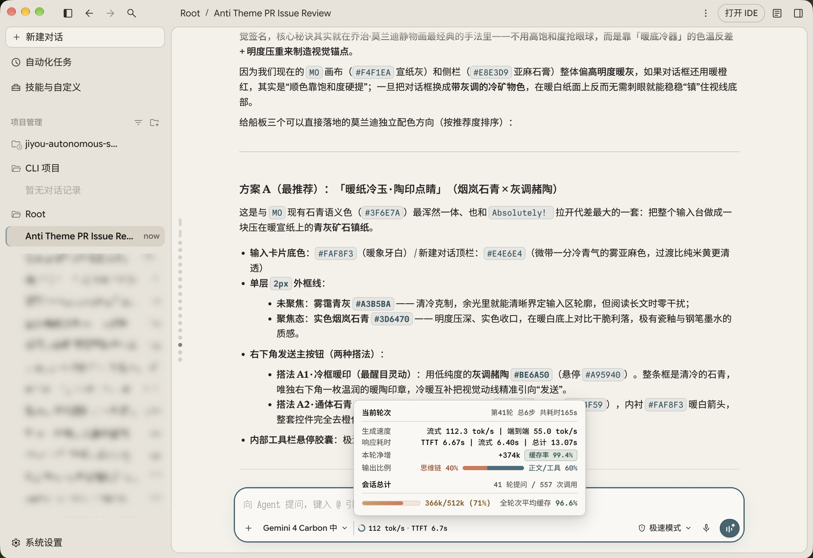

# 船板的 Antigravity 主题、字体与汉化补丁 (v6.0.2)

[-339933.svg)](https://nodejs.org/)

面向 Google Antigravity（支持 `2.34.0+`）的轻量级外观、排版、汉化与本地只读统计增强补丁。专注于纯粹的界面审美与信息可读性优化，由 AI Agent 一键部署，支持热重载个性化定制与随时无损还原。

> 供 AI Agent 读取的完整部署与改装契约见仓库根目录 **[`SKILL.md`](https://github.com/Anarcadia/chuanban-antigravity-theme-patch/blob/main/SKILL.md)**，历史版本记录见 **[`CHANGELOG.md`](CHANGELOG.md)**。

---

## ✨ 核心特性

- **多套打磨风格自由切换**：内置温润耐看的**莫兰迪古典矿物风格**（默认）、深度打磨的**仿 Claude 书卷暖白风格（`Absolutely！`）**、护眼的**温润书卷夜间风格**与深海冷碳深色模式，并支持在设置面板一键切回**官方原版风格**（同步恢复官方原版字体）。
- **母语级汉化与中英一键双切**：覆盖主界面、设置项、编排器与子 Agent 面板的自然中文汉化，严格隔离代码块、终端与文件名避免误翻；外观面板提供 **`[ EN | 中文 ]`** 独立按钮，可随时一键退回纯英文原版界面。
- **字体美化与润墨感特效**：精选书卷衬线长文、现代无衬线界面与人文等宽代码字体组合，并在浅色纸面融入细腻的活字微润墨效果，柔化电子屏笔画生硬感，增加典雅温润的层次质感。
- **精细中西文混排调校**：按界面 UI、对话正文、代码终端与输入框分层桥接中西文字重比例，消除中英文混排发虚与字重断层。
- **极简美观的上下文信息胶囊**：在输入框底栏内嵌低干扰状态胶囊，支持主窗口、分屏、支线提问与子 Agent 独立显示生成速率、首字延迟与上下文占用圆环，悬停即可查看当轮与会话级精简指标。
- **后台深度信息概括面板**：在系统设置中集成「Token 统计」面板，按时间趋势、模型与配额池、工作场景及父子会话维度直观概括历史消耗与缓存命中表现。
- **纯粹克制与非侵入式低风险设计**：严格限定于纯前端视觉呈现与本地数据只读展示，不掺杂任何对话流自动化、网络拦截或凭据读取等累赘高危功能；不修改客户端安装包与系统签名（注：运行时渲染层注入仍属客户端条款灰区，并非绝对零风险，支持随时一键彻底卸载还原）。
- **流畅不卡顿的渲染优化**：常驻隔离字库定义并精简样式匹配与 DOM 监听范围，切英文态自动休眠文本观察器，保证高频流式输出、长列表滚动与主题秒切丝滑无感。
- **本地只读增量解析**：基于 Node.js 原生 SQLite 接口对本地（及 WSL2）会话库做只读增量读取与本地索引缓存，快速响应且不阻塞主界面渲染。
- **内核与配置分离的热重载架构**：通过单图标端口接力与轻量后台守护运行，只读内核 `core/` 与用户配置 `user/` 物理分离，日常调整配色或词条保存即热生效，版本升级不覆盖个人设置。

---

## 🎨 配色与主题体系

在「系统设置 → 外观界面」可直接通过五段式胶囊 **`[ A | ✳️ | MO | 📖 | 🌙 ]`** 切换全局风格：

| 按钮 | 预设名称 | 风格定位 |
| :---: | :--- | :--- |
| **`MO`** *(默认)* | **莫兰迪色** (`morandi`) | **暖底冷器 · 耐看静物感**：暖宣纸浅灰画布搭配亚麻侧栏，输入框与主按钮采用沉稳醒目的烟岚石青单线收口。 |
| **`✳️`** | **Absolutely！** (`absolutely`) | **仿 Claude 经典暖白**：微暖亮白纸面配暖燕麦侧栏，搭配信封火漆暖橙输入框与陶土橙按钮，对比鲜明。 |
| **`📖`** | **暖纸深色** (`claude-warm`) | **温润书卷夜间**：仿 Claude 暖炭纸底配象牙白字色与陶土暖橙点缀，适合夜间长时间沉浸阅读与写作。 |
| **`🌙`** | **深色** (`onyx`) | **深海冷碳夜间**：深海青黛暗底配石青点缀，冷静克制，适合代码审阅与暗光环境。 |
| **`A`** | **原版配色** (`native`) | **官方原貌直通**：一键旁路补丁配色与自定义字体，回归客户端原生白/黑外观，同时保留汉化与统计组件可用。 |

---

## 🖼️ 实机效果

### 1. 默认标准主界面：莫兰迪风格（`MO`）与上下文信息胶囊详情卡

### 2. 外观与语言切换面板：五段式皮肤选择 + `[ EN | 中文 ]` 一键双切

### 3. `Absolutely！` 主题演示：仿 Claude 书卷暖白工作台与子 Agent 汉化副栏

### 4. 夜间界面与代码审阅视图（支持 `📖 暖纸深色` / `🌙 深色` 切换）

---

## 🚀 安装、升级与日常定制

### 一、新用户首次安装
1. **环境准备**：安装 **Node.js `>= 22.0.0`**（推荐 **`>= 22.13.0`** 以启用信息胶囊与 Token 统计）。必备字体支持 Agent 通过脚本**一键自动下载并注册**；仅当本机终端网络无法直连 Google Drive 时，再从底部 [**Google Drive 资源包**](https://drive.google.com/drive/folders/1NX92SgVUqtSjWg6bt6sIJXy-cn7J_boC) 经浏览器手动下载。
2. **复制以下引导词发给你的 AI Agent（Antigravity / Claude Code / Codex / Cursor 等）**：

> **💬 复制发给 Agent（新用户一键安装）**：  
> 请帮我克隆 `https://github.com/Anarcadia/chuanban-antigravity-theme-patch.git`（或读取我已下载解压的补丁目录），先完整阅读仓库内的 `SKILL.md`，再按以下顺序部署并处理边缘情况：  
> 1. 若本机有 `nvm` / `fnm` / `volta`，优先切换至 `Node >= 22.13.0` 执行命令；运行 `node install.mjs doctor` 检查 `fonts.allRequiredInstalled` 与 `fonts.unregisteredWarning`。  
> 2. 若缺少字体（或 Windows 提示有未写注册表的用户字体）：
>    - 若我本地已下载好字体目录或 `.zip`，直接执行 `node install.mjs install-fonts --from "<字体目录或.zip路径>"`（支持自动解压 `.zip`，Windows 下自动用 UTF-16 注册表写入并广播，勿仅手动复制文件）；
>    - 若本地尚未下载，**直接执行 `node install.mjs install-fonts --auto-download`**（若 Windows 检出旧版 `SuperTTC` 请追加 `--retire-super-ttc`），脚本会自动下载缺失的 `Anthropic Serif/Mono` 与 `170 MB` 精简拆分版更纱黑体 `.zip` 并完成注册；
>    - 仅当终端网络/代理受限导致 `--auto-download` 失败时，才提示我用浏览器从 Google Drive 共享目录下载 `AnthropicSerif-Regular/Bold.ttf`、`AnthropicMono-Regular.ttf` 及 [`Windows-Sarasa-Split-SC-TTF-v1.0.43.zip`](https://drive.google.com/file/d/1iVVvZXtwUcDiHy42tJ25X6N-JlOf3l7A/view?usp=sharing)，下载后交由 `install-fonts --from` 安装（macOS 缺少更纱也可用 `brew install --cask font-sarasa-gothic`）。
> 3. 运行 `node install.mjs install` 完成安装（默认启用 `"morandi"` 莫兰迪风格；macOS 默认单图标模式 `launcherInstalled: false` 属正常设计）。
> 4. 检查输出中的 `cdpStatus`（以及 Windows 新装字体后的 `restartAntigravityRequired`）：若为 `"missing_opt_in_flag"` 或 Windows 刚新装完字体，**如果你当前正在 Antigravity 内部对话中运行，请勿执行 `--force` 强行重启自断会话**，只需把空闲时执行的命令 `node ~/.gemini/antigravity/theme-patch/install.mjs relaunch`（Windows 为 `node "$HOME\.gemini\antigravity\theme-patch\install.mjs" relaunch`，或提示我手动退出重开一次客户端）发给我；如果你在外部独立终端运行且客户端空闲，请直接执行 `node install.mjs relaunch`。
> 5. 在端口就绪后运行 `node install.mjs verify`，确认 `"ok": true`、`"hasStyle": true` 且 `fonts.allRequiredInstalled: true` 即完成验收。

### 二、老用户升级至 v6.0.2
`node install.mjs install` 会自动备份旧版 `core/` 内核、将旧版默认浅色预设平滑迁移至 `"morandi"`，并完整保留 `user/` 目录下的个人自定义设置：

> **💬 复制发给 Agent（老用户无缝升级）**：  
> 请帮我拉取最新的 `https://github.com/Anarcadia/chuanban-antigravity-theme-patch.git`（或读取最新解压目录），阅读其中的 `SKILL.md` 后直接运行 `node install.mjs install` 升级至 `v6.0.2`（若我此前使用的是早期单文件版脚本且有自定义字号/配色，请先迁移到 `~/.gemini/antigravity/theme-patch/user/`）。若安装后 `cdpStatus` 为 `"missing_opt_in_flag"` 且你正在 Antigravity 内部会话中运行，请勿直接中断当前对话，告诉我空闲时运行 `node ~/.gemini/antigravity/theme-patch/install.mjs relaunch`（或手动重开一次客户端）即可；端口已就绪则直接运行 `node install.mjs verify` 验收。

### 三、日常定制与排障话术
- **🎨 切换风格、语言或微调字号**：日常切换主题与中英文可直接在「系统设置 → 外观界面」点击对应按钮；如需修改扩展预设或字号，可让 Agent 按 `SKILL.md` 修改 `user/config.json`（如调大 `"--ag-chat-font-size"`）。
- **🇨🇳 自定义词条覆盖**：在 `~/.gemini/antigravity/theme-patch/user/i18n.override.json` 中写入 `"英文原词": "自定义中文"`，保存后自动热生效。
- **🔍 故障定界、回滚与卸载**：可让 Agent 依次运行 `node install.mjs doctor` 与 `node install.mjs verify --safe-mode` 排查配置冲突；退回上一版本运行 `node install.mjs rollback`，彻底卸载还原运行 `node install.mjs uninstall`。

---

## 🛡️ 开发红线、合规边界与免责声明

- **开发红线（致贡献者与 AI Agent）**：本仓库 `main` 分支的后续全部功能迭代（包括但不限于 Token 统计、UI 扩展与主题增强）**坚决不加入**任何自动发送消息/自动化操控对话流、绕过配额或模型限制、拦截或篡改网络请求与请求头、读取/导出 OAuth 凭据、屏蔽官方遥测，以及修改/破解客户端 `.asar` 或二进制签名的功能，从源头杜绝触发账号风控与安全合规风险。
- **合规边界与免责声明**：本项目为独立的非官方社区视觉、汉化与本地只读统计辅助补丁，与 Google 没有任何关联、背书或合作关系。补丁仅在本地渲染层注入样式/界面文案并以只读方式解析本地会话 SQLite，不修改客户端安装包与代码签名、不代理模型请求、不接触鉴权凭据。鉴于商业客户端软件服务条款（ToS）对运行时前端修改存在字面灰区，且官方客户端策略与调试端口机制可能随时变更，本项目按「现状（AS IS）」提供，不对其长期可用性或合规状态作任何担保；使用者需自行评估并承担相应风险，亦可随时运行 `node install.mjs uninstall` 彻底卸载并还原为官方原版状态。

---

## 🔗 资源入口

| 入口 | 地址 | 说明 |
| :--- | :--- | :--- |
| **1. Google Drive 资源包（含字体）** | [**Google Drive 共享文件夹**](https://drive.google.com/drive/folders/1NX92SgVUqtSjWg6bt6sIJXy-cn7J_boC) | 含成品包与必备字体：`AnthropicSerif-Regular/Bold.ttf`、`AnthropicMono-Regular.ttf`、**Windows 专用精简拆分字体包 [`Windows-Sarasa-Split-SC-TTF-v1.0.43.zip`](https://drive.google.com/file/d/1iVVvZXtwUcDiHy42tJ25X6N-JlOf3l7A/view?usp=sharing)**（避免大体积单体 `SuperTTC` 在 Windows 下引发卡顿）及 macOS/Linux 用 `Sarasa-SuperTTC.ttc`（macOS 亦可直接 `brew install --cask font-sarasa-gothic`）。 |
| **2. GitHub 代码仓库** | [**Anarcadia/chuanban-antigravity-theme-patch**](https://github.com/Anarcadia/chuanban-antigravity-theme-patch) | 预封装内核 `core/`、个人改装层 `user/`、生命周期 CLI `install.mjs`、[`SKILL.md`](https://github.com/Anarcadia/chuanban-antigravity-theme-patch/blob/main/SKILL.md) 与 [`CHANGELOG.md`](CHANGELOG.md)。 |
| **3. Notion 引导页** | [**chuanban-antigravity-theme-patch**](https://chuanban.notion.site/chuanban-antigravity-theme-patch-db7c5846f37546be9481cd791aed0554) | 图文说明与安装引导镜像页。 |
